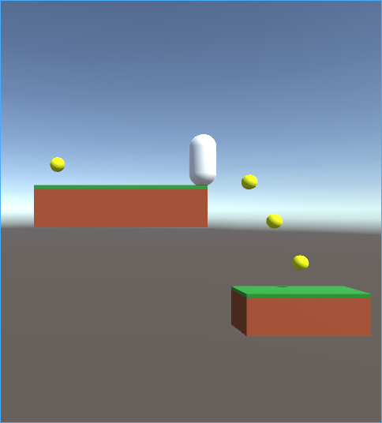

# IslandRun

Bölümü oynandıkça kendiliğinden uzayan, 2D sonsuz koşu oyunu denemesi.

## Neden?

Başka bir oyun projesinde kullanmak üzere sonsuz bölüm üretme yapısını denemek için yapıldı. Hazır bir eğitim paketinin karakter ve bölüm üretme kodları üzerine kuruldu.

## Nasıl çalışıyor

- Oyun başlarken önceden hazırlanmış bölüm parçalarından beşi art arda diziliyor.
- Karakter son parçanın sonuna yaklaştıkça listeden rastgele seçilen yeni bir parça ekleniyor; yol böylece hiç bitmiyor.
- Parçalarda toplanacak altınlar ve dikenler var. Toplanan altınlar ekranda sayılıyor, dikene değince oyun bitiyor.

## Teknik

| | |
|---|---|
| **Motor** | Unity 2021.3.3f1, 2D |
| **Kod** | `Assets/RunnerMapGeneration` (bölüm üretme, altın, diken, oyun sonu), `Assets/_` (karakter ve yardımcı kodlar) |
| **GitHub'a yükleme** | Mart 2023 |
